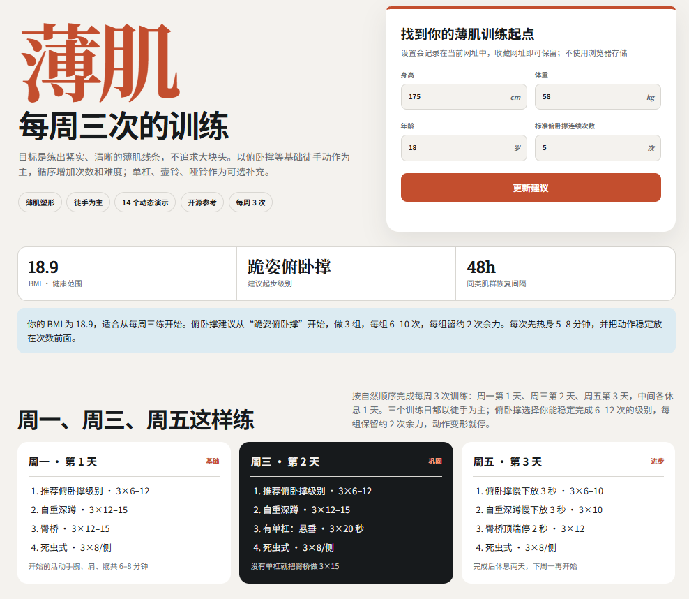

# 薄肌训练 | 每周三次的训练



一套每周三次、以徒手为主的居家薄肌训练计划：目标是练出紧实、清晰的薄肌线条，不追求大块头。

- 在线访问：https://bj.xbaimen.com/
- 作者：[@idsahm](https://x.com/idsahm)
- 14 个动作，含循环演示动图与动作步骤（徒手 6 / 单杠 1 / 壶铃 5 / 哑铃 2）
- 身体评估：输入身高、体重、年龄、俯卧撑次数，自动计算 BMI 与训练建议
- 设置记忆：修改设置后网址会自动带上参数（如 `#h=175&w=58&a=18&p=5`），收藏网址即可保留设置，不使用浏览器存储

## 文件结构

```
index.html   # 网站全部代码（单文件）
images/      # 14 张动作演示 GIF + 分享预览图 preview.jpg
CNAME        # 自定义域名
```

## 本地预览

直接用浏览器打开 `index.html` 即可（图片使用相对路径引用 `images/`）。
